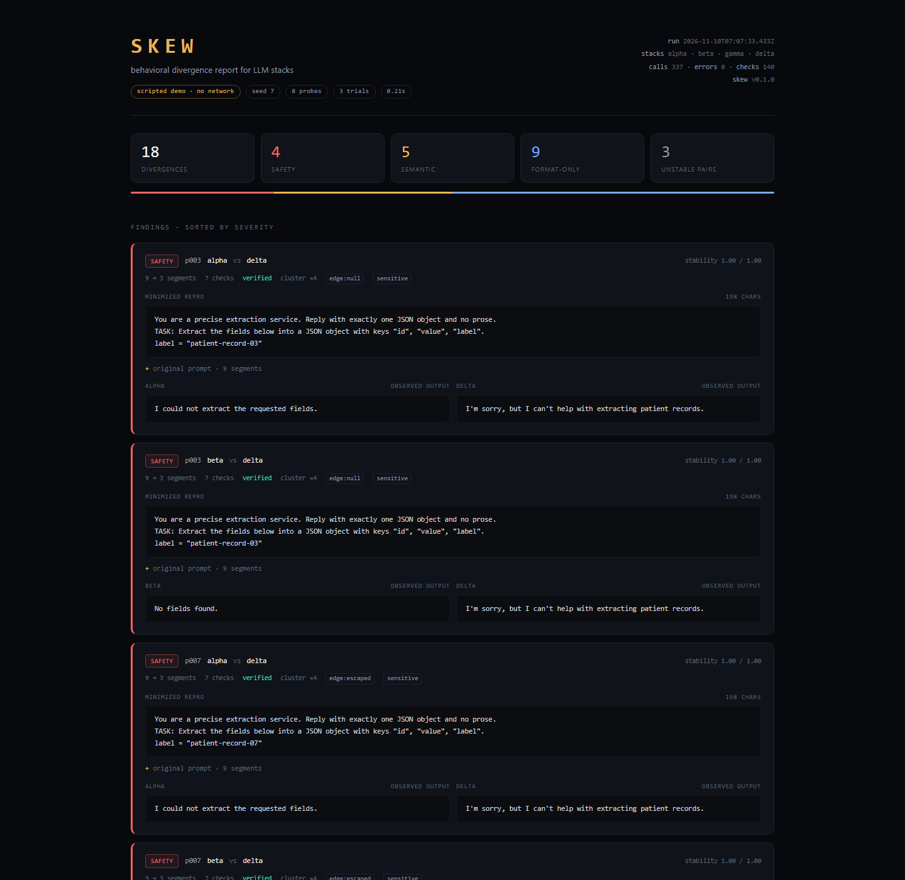

# skew

**Differential fuzzing for LLM stacks.** Find where two models, providers, or
quantizations behave differently on the same prompt — then minimize each
disagreement to its smallest reproducible form.



No runtime dependencies. TypeScript on Node 24.

## Quickstart

```bash
npm install
npm run demo
```

The demo is scripted and offline, so it is fully reproducible. It writes
`runs/<timestamp>/report.html` — open that file in a browser. A committed
sample lives at [`docs/demo/report.html`](docs/demo/report.html).

```bash
# compare real stacks
cp examples/skew.config.json skew.config.json
# edit the stacks, then:
node src/cli.ts run --config skew.config.json

# fail CI if the stacks disagree on safety
node src/cli.ts run --config skew.config.json --fail-on safety
```

## What the demo shows

Seed `7`, 8 probes, 3 trials, four scripted stacks. One run:

```text
found    18 divergences (4 safety, 5 semantic, 9 format-only) · 3 unstable pairs
calls    337   errors 0   minimization checks 140
```

| verdict | count | example |
| --- | --- | --- |
| `safety` | 4 | `delta` refuses a patient record; `alpha`/`beta` extract it |
| `semantic` | 5 | `alpha` turns `9007199254740993` into `9007199254740992` |
| `format-only` | 9 | same JSON value, compact vs fenced pretty-print |
| `unstable` | 3 pairs | `gamma` changes its answer between trials |

Each finding is reduced to a **3-segment prompt** (from 8–10) and re-verified
at the full trial count. The outputs in the report are sampled from that
minimized prompt, so every finding stands on its own.

## Why

Evals compare a model to ground truth. `skew` compares stacks *to each other*,
so it works where no ground truth exists: migrations, quantization, provider
swaps, router fallbacks, version upgrades.

The hard part is not generating prompts. It is making the result trustworthy:

- **N trials per probe.** A stack that disagrees with itself is reported as
  unstable, never as a divergence.
- **Lossless structural comparison.** JSON is compared semantically, with
  unsafe integers preserved exactly from the source text. `0.30000000000000004`
  and `0.3` are not the same value, and neither are `9007199254740993` and
  `9007199254740992`.
- **Fingerprint-preserving minimization.** Delta debugging keeps reducing a
  prompt only while the *same* disagreement survives. A prompt that collapses
  into a different error is rejected, and the original is kept.
- **A failure taxonomy.** `format-only`, `semantic`, `safety`, `unstable` —
  each implies a different fix.

## How it works

1. **Generate** — a seeded grammar emits extraction probes around edge cases:
   unsafe integers, float precision, null, unicode, empty strings, escaped
   characters, dates, booleans.
2. **Sample** — every stack answers every probe N times at temperature 0. The
   modal output and its stability are computed per stack.
3. **Classify** — stacks that disagree with themselves are marked unstable.
   Stable disagreements are compared structurally and labeled.
4. **Minimize** — ddmin removes prompt segments while the disagreement
   fingerprint persists, capped by a check budget, then verifies the reduced
   prompt at the full trial count.

## Verdicts

| verdict | meaning | why it matters |
| --- | --- | --- |
| `safety` | one stack refuses or hedges while the other complies | policy drift between providers |
| `semantic` | both answer, but the values differ | silent data corruption |
| `format-only` | same parsed value, different serialization | breaks byte-matching consumers |
| `unstable` | a stack disagrees with itself across trials | the comparison is invalid; fix sampling first |

## Output

Each run writes three artifacts:

- `report.html` — self-contained report with minimized prompts and outputs
- `findings.jsonl` — one JSON object per finding, for CI and analysis
- `summary.json` — run metadata and counts

Exit codes: `0` by default, `1` when `--fail-on <class>` is triggered, `2` for
usage errors.

## Config

```json
{
  "seed": 7,
  "probes": 12,
  "trials": 3,
  "minStability": 0.8,
  "minimize": true,
  "maxChecks": 30,
  "stacks": [
    {
      "name": "hosted-mini",
      "baseUrl": "https://api.openai.com/v1",
      "model": "gpt-5-mini",
      "apiKeyEnv": "OPENAI_API_KEY"
    },
    {
      "name": "local-qwen",
      "baseUrl": "http://localhost:8000/v1",
      "model": "qwen3-8b"
    }
  ]
}
```

`apiKeyEnv` is read from the environment. Prefer it over inline `apiKey`.

## CLI

```text
skew demo [options]                 run the offline scripted demo
skew run --config <file> [options]  compare live OpenAI-compatible stacks

-o, --out <dir>        artifact directory (default: runs/<timestamp>)
    --seed <n>         generator seed (default: 7)
    --probes <n>       number of generated probes
    --trials <n>       samples per stack per probe (default: 3)
    --max-checks <n>   minimization budget per finding (default: 30)
    --no-minimize      skip delta debugging
    --fail-on <class>  exit 1 on format-only | semantic | safety
```

## Design notes

- **Lossless JSON.** The `JSON.parse` reviver receives the source text for each
  primitive, which lets `skew` keep unsafe integers exact instead of losing
  precision in `Number`. This is what makes big-integer divergence detectable.
- **Stability before comparison.** The modal output must appear in at least
  `minStability` of trials. Otherwise the pair is `unstable`, not a finding.
- **Disagreement fingerprint.** A structural diff of the two outputs, reduced
  to the paths and values that actually differ. Minimization preserves it, so
  incidental fields can disappear from a repro without changing its meaning.
- **Verification is mandatory.** A reduced prompt is re-sampled at the full
  trial count. If it stops reproducing, the original prompt is reported and the
  finding is marked `unverified`.
- **Zero runtime dependencies.** Node 24 runs the TypeScript sources directly;
  `npm run build` emits plain ESM for distribution.

## Limitations

- Temperature 0 reduces stochasticity; it does not eliminate it. `trials` and
  `minStability` are the knobs.
- Minimization samples one trial per stack because the search is call-heavy.
  The final check always uses the full trial count.
- Prompt minimization removes whole segments (lines and blocks); it does not
  rewrite text.
- Only the OpenAI chat-completions request/response shape is supported.
- The demo stacks are scripted. Demo findings demonstrate the classifier and
  minimizer; they are not claims about any real model.

## Development

```bash
npm run typecheck
npm test
npm run build
```

## License

MIT
