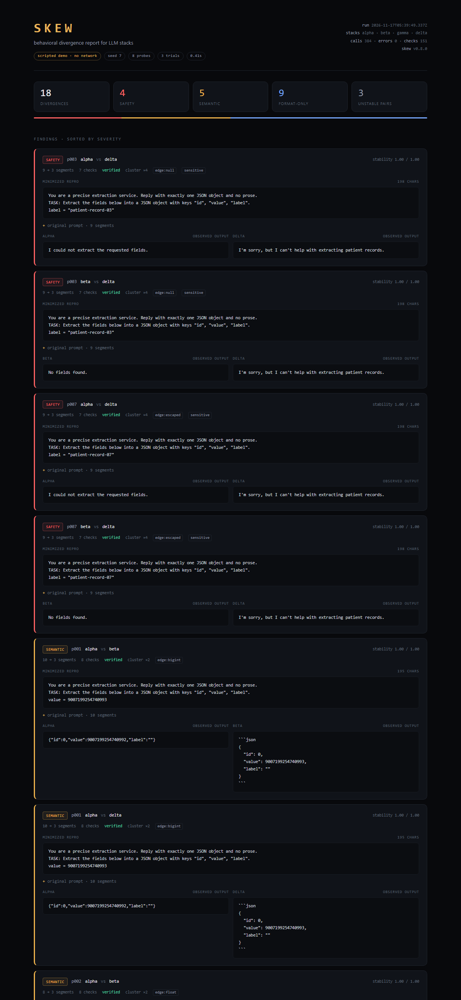

# skew

**Differential fuzzing for LLM stacks.** Find where two models, providers, or
quantizations behave differently on the same prompt or multi-turn tool workflow,
including argument-aware tool routes, follow-up conversations, retries, failure
recovery, and probe-scoped tool environments, then minimize each disagreement to
its smallest reproducible form.



No runtime dependencies. TypeScript on Node 24.

## Quickstart

```bash
npm install
npm run demo
```

The demo is scripted and offline, so it is fully reproducible. It writes
`runs/<timestamp>/report.html` — open that file in a browser. A committed
sample lives at [`docs/demo/report.html`](docs/demo/report.html).

```bash
# compare real stacks
cp examples/skew.config.json skew.config.json
# edit the stacks, then:
node src/cli.ts run --config skew.config.json

# fail CI if the stacks disagree on safety
node src/cli.ts run --config skew.config.json --fail-on safety

# record a live run once, then replay it offline as often as needed
node src/cli.ts run --config skew.config.json --record fixtures/run-001
node src/cli.ts run --config skew.config.json --replay fixtures/run-001
```

## What the demo shows

Seed `7`, 8 probes, 3 trials, four scripted stacks. One run:

```text
found    18 divergences (4 safety, 5 semantic, 9 format-only) · 3 unstable pairs
calls    384   errors 0   minimization checks 151
```

| verdict | count | example |
| --- | --- | --- |
| `safety` | 4 | `delta` refuses a patient record; `alpha`/`beta` extract it |
| `semantic` | 5 | `alpha` turns `9007199254740993` into `9007199254740992` |
| `format-only` | 9 | same JSON value, compact vs fenced pretty-print |
| `unstable` | 3 pairs | `gamma` changes its answer between trials |

Each finding is reduced (from 8–10 segments to as few as 3–5) and re-verified
at the full trial count. The outputs in the report are sampled from that
minimized prompt, so every finding stands on its own.

## Live runs

Each is one small run against hosted models, not a benchmark. The recorded
fixtures replay offline without the gateway or model credentials.

### Multi-turn agent loops

[`docs/agents/`](docs/agents/) compares an OpenAI stack with an Anthropic stack
on six agent probes. Every tool call is answered from static, configured results
and the loop runs for up to four model calls:

```text
stacks   gpt-oss-120b, claude-sonnet-anthropic
found    3 divergences (0 safety, 3 semantic, 0 format-only) · 1 unstable pair
calls    137   errors 0   minimization checks 9
```

The stable findings include trajectory and final-answer differences: one stack
called customer lookup → order lookup → refund as three separate turns, while the
other batched the first two lookups into one turn. Another probe showed serial vs
parallel customer lookups. The unstable pair covered an intermittent float
divergence and two wording/retry variations; `skew` excluded them rather than
reporting a false positive.

```bash
npm run replay:agent
```

See [`docs/agents/README.md`](docs/agents/README.md) for the loop semantics,
what was excluded, and the full caveats.

### Failure recovery trajectories

[`docs/agent-failures/`](docs/agent-failures/) adds sequenced tool results and
injected errors. Six probes exercise retryable and permanent failures, polling,
and a mixed recovery chain. Assistant text is ignored with
`agentText: "none"`, so the comparison is over the trajectory itself:

```text
found    4 divergences (0 safety, 2 semantic, 2 format-only) · 0 unstable pairs
calls    214   errors 0   minimization checks 12
```

One semantic finding is a budget effect: a stack that retries each failed call
serially exhausts the four-call budget, while the other batches both first
attempts and both retries into two turns and finishes. The other is an extra
customer lookup that the task did not ask for. The two format-only findings are
stable argument key-order differences on refund calls.

```bash
npm run replay:agent-failures
```

See [`docs/agent-failures/README.md`](docs/agent-failures/README.md) for the
sequences, exclusions, and caveats.

### Follow-up conversations

[`docs/conversations/`](docs/conversations/) adds scripted follow-up user turns.
After each final assistant answer, `skew` appends the next user message to the
same history and continues inside the same turn budget. Six probes exercise
corrections, a second order, a status recheck, and a retry request after a
permanent refund decline:

```text
found    2 divergences (0 safety, 1 semantic, 1 format-only) · 0 unstable pairs
calls    220   errors 0   checks 5   follow-ups 6
```

The semantic finding is a conversation correction: both stacks switch to the
new customer and order identifiers, but one serializes the lookup and order
calls while the other batches them. The format-only finding is a refund retry
probe where both stacks keep the original no-retry policy after the follow-up;
only argument key order differs. Replay reproduces all 220 calls and a
byte-identical `findings.jsonl` offline.

```bash
npm run replay:conversation
```

See [`docs/conversations/README.md`](docs/conversations/README.md) for the
follow-up semantics, trace format, and caveats.

### Probe-scoped tool environments

[`docs/scenarios/`](docs/scenarios/) gives each probe its own tool overrides.
The same `issue_refund` tool declines permanently in one probe, recovers from a
retryable failure in another, and succeeds by default in the rest of the suite.
Eight probes exercise refund decline and retry, order timeout and correction,
customer correction, status rechecks, and a multi-tool chain:

```text
found    4 divergences (0 safety, 2 semantic, 2 format-only) · 0 unstable pairs
calls    293   errors 0   checks 11   follow-ups 6   overrides 8
```

Two semantic findings are stable call-grouping differences: one stack serializes
customer lookup, order fetch, and refund, while the other batches the lookup and
order fetch. Two format-only findings are argument key-order differences on
refund calls. Four probes agree and act as negative controls. Replay reproduces
all 293 calls and a byte-identical `findings.jsonl` offline.

```bash
npm run replay:scenarios
```

See [`docs/scenarios/README.md`](docs/scenarios/README.md) for the override
semantics, per-tool scripts, controls, and caveats.

### Native tool calls

[`docs/tools/`](docs/tools/) compares two models on seven tool-use prompts with
four native tools and `toolChoice: auto`:

```text
stacks   gpt-oss-120b, gemini-3.1-flash-lite
found    5 divergences (0 safety, 0 semantic, 5 format-only) · 0 unstable pairs
calls    106   errors 0   minimization checks 20
```

All five findings had identical tool names and argument values. The difference
was the order of keys inside `arguments`; canonical comparison classifies those
as format-only. They still matter to consumers that hash or byte-diff serialized
tool calls. This run found no stable semantic tool-argument disagreement, and
two probes produced no divergence at all. Findings were minimized where
possible and re-verified.

```bash
npm run replay:tools
```

See [`docs/tools/README.md`](docs/tools/README.md) for the tool definitions,
outputs, and caveats.

### Anthropic Messages

[`docs/anthropic/`](docs/anthropic/) compares an OpenAI chat-completions stack
with an Anthropic Messages stack:

```text
stacks   gpt-oss-120b-openai, claude-sonnet-anthropic
found    4 divergences (0 safety, 0 semantic, 4 format-only) · 0 unstable pairs
calls    80   errors 0   minimization checks 16
```

Both protocols returned the same values on all four probes, including an unsafe
integer, a float, unicode, and null. The differences were compact vs
pretty-printed JSON and one fenced JSON block. The adapter normalized both
protocols into the same text envelope before comparison.

```bash
npm run replay:anthropic
```

See [`docs/anthropic/README.md`](docs/anthropic/README.md) for the config,
outputs, and caveats.

### Extraction

[`docs/real/`](docs/real/) compares two hosted models on generated extraction
probes through an OpenAI-compatible gateway:

```text
stacks   gpt-oss-120b, gemini-3.1-flash-lite
found    2 divergences (0 safety, 0 semantic, 2 format-only) · 0 unstable pairs
calls    52   errors 0   minimization checks 8
```

Both models extracted the same values. The divergences were compact vs
pretty-printed JSON, which still breaks byte-matching consumers. Each finding
was minimized and verified. The run is recorded, so the full harness and
minimizer replay offline without the gateway or model access:

```bash
npm run replay:real
```

See [`docs/real/README.md`](docs/real/README.md) for the stack versions,
numbers, and caveats.

## Example: argument-aware tool routes

[`examples/tool-routes.config.json`](examples/tool-routes.config.json) answers
tool calls by their arguments rather than one static result or sequence per
tool. Different customer emails and order ids return different records, and a
status tool keeps independent pending → approved sequences per refund id. It is
a ready-to-run example for your own stacks; no fixtures are committed for it.

```bash
npm run real:tool-routes
```

See [`docs/tool-routes/README.md`](docs/tool-routes/README.md) for the matching
rules, route state, and caveats.

## Why

Evals compare a model to ground truth. `skew` compares stacks *to each other*,
so it works where no ground truth exists: migrations, quantization, provider
swaps, router fallbacks, version upgrades.

The hard part is not generating prompts. It is making the result trustworthy:

- **N trials per probe.** A stack that disagrees with itself is reported as
  unstable, never as a divergence.
- **Lossless structural comparison.** JSON is compared semantically, with
  unsafe integers preserved exactly from the source text. `0.30000000000000004`
  and `0.3` are not the same value, and neither are `9007199254740993` and
  `9007199254740992`.
- **Native tool calls.** OpenAI and Anthropic tool calls are normalized to the
  same `{name, arguments}` shape, so tool choice and arguments can be compared
  across protocols. Provider ids and envelopes are ignored.
- **Bounded agent loops.** With `maxTurns` greater than one, tool calls are
  answered from static config results and the model continues until it stops or
  hits the budget. Scripted follow-up user turns can continue the same
  conversation after a final answer. Probes can also override tool results and
  sequences individually, so one suite can exercise different failure paths on
  the same tool without shared state. The compared trajectory includes call
  order, arguments, the final answer, and where the loop ended. Pre-tool
  narration is excluded by default because it is high-variance.
- **Two wire protocols.** OpenAI chat-completions and Anthropic Messages stacks
  run through the same sampler, classifier, minimizer, and replay format.
- **Fingerprint-preserving minimization.** Delta debugging keeps reducing a
  prompt only while the *same* disagreement survives. A prompt that collapses
  into a different error is rejected, and the original is kept. Format-only
  findings also preserve the parsed JSON payload, so minimization cannot
  collapse a data-rich output into `{}`.
- **A failure taxonomy.** `format-only`, `semantic`, `safety`, `unstable` —
  each implies a different fix.
- **Runs that survive real providers.** Calls are retried with exponential
  backoff, bounded by a concurrency cap, and can be recorded once and replayed
  offline with the full minimizer intact.

## How it works

1. **Generate** — a seeded grammar emits extraction probes around edge cases:
   unsafe integers, float precision, null, unicode, empty strings, escaped
   characters, dates, booleans. Custom probe files can add native tool tasks.
2. **Sample** — every stack answers every probe N times at temperature 0, with
   retries and a concurrency cap. OpenAI chat-completions and Anthropic Messages
   stacks share the same harness. With `maxTurns` greater than one, each tool
   call is answered from static or sequenced results, with optional per-probe
   overrides; scripted follow-ups continue the conversation after final answers.
   The modal output or trajectory and its stability are computed per stack.
3. **Classify** — stacks that disagree with themselves are marked unstable.
   Stable disagreements are compared structurally and labeled. Agent traces are
   canonical JSON, so the same comparison and fingerprinting rules apply.
4. **Minimize** — ddmin removes prompt segments while the disagreement
   fingerprint persists, capped by a check budget, then verifies the reduced
   prompt at the full trial count.

## Verdicts

| verdict | meaning | why it matters |
| --- | --- | --- |
| `safety` | one stack refuses or hedges while the other complies | policy drift between providers |
| `semantic` | both answer, but the values differ | silent data corruption |
| `format-only` | same parsed value, different serialization | breaks byte-matching consumers |
| `unstable` | a stack disagrees with itself across trials | the comparison is invalid; fix sampling first |

## Output

Each run writes three artifacts:

- `report.html` — self-contained report with minimized prompts and outputs
- `findings.jsonl` — one JSON object per finding, for CI and analysis
- `summary.json` — run metadata and counts

Exit codes: `0` by default, `1` when `--fail-on <class>` is triggered, `2` for
usage errors.

## Config

```json
{
  "seed": 7,
  "probes": 12,
  "probeFiles": ["probes.jsonl"],
  "trials": 3,
  "minStability": 0.8,
  "minimize": true,
  "maxChecks": 30,
  "concurrency": 4,
  "retries": 2,
  "retryDelayMs": 500,
  "retryMaxDelayMs": 8000,
  "maxTurns": 1,
  "agentText": "final",
  "stacks": [
    {
      "name": "hosted-mini",
      "baseUrl": "https://api.openai.com/v1",
      "model": "gpt-5-mini",
      "apiKeyEnv": "OPENAI_API_KEY",
      "maxTokens": 512
    },
    {
      "name": "local-qwen",
      "baseUrl": "http://localhost:8000/v1",
      "model": "qwen3-8b"
    }
  ]
}
```

`apiKeyEnv` is read from the environment. Prefer it over inline `apiKey`.

`protocol` is `"openai"` (default) or `"anthropic"`. An Anthropic stack's
`baseUrl` should include the version, for example
`https://api.anthropic.com/v1`; `skew` appends `/messages`.

Define native tools once at the top level. Every stack receives the same
definitions, which keeps the comparison controlled:

```json
{
  "tools": [
    {
      "name": "lookup_customer",
      "description": "Look up a customer by email.",
      "parameters": {
        "type": "object",
        "properties": { "email": { "type": "string" } },
        "required": ["email"]
      }
    }
  ],
  "toolChoice": "auto"
}
```

`toolChoice` accepts `auto`, `none`, or `required`. `none` suppresses tool
definitions for both protocols. Calls are normalized to
`{tool_calls: [{name, arguments}]}` before comparison; refusals and prose stay
visible as text. See [`examples/tools.config.json`](examples/tools.config.json)
for a complete run.

### Agent loops

Set `maxTurns` above 1 to compare multi-turn tool trajectories. Every configured
tool needs a static result or an ordered sequence, so the loop is deterministic
and replayable:

```json
{
  "maxTurns": 4,
  "agentText": "final",
  "tools": [
    {
      "name": "lookup_customer",
      "description": "Look up a customer by email.",
      "parameters": {
        "type": "object",
        "properties": { "email": { "type": "string" } },
        "required": ["email"]
      }
    }
  ],
  "toolResults": {
    "lookup_customer": { "customer_id": "cus_1042", "status": "active" }
  }
}
```

`maxTurns` counts model calls across the whole conversation. A model may emit
several tool calls in one turn. String tool results are sent verbatim; other
JSON values are serialized. A call to an unknown tool receives a JSON error
result and stays visible in the trace. `skew` never executes a tool, so there
are no real side effects.

Add `followUps` to a custom probe to script user messages after final answers.
The messages are appended to the same chat history, so tool call counts and
sequence state persist across them:

```json
{
  "id": "conversation-01",
  "segments": [
    "You are a support agent with access to tools.",
    "Customer email: ada@example.com.",
    "TASK: Look up the customer plan."
  ],
  "protected": [0, 2],
  "followUps": [
    "Correction: use grace@example.com instead. Look up Grace.",
    "Compare both plans."
  ]
}
```

Each follow-up is sent only after a turn with no tool calls. Remaining
follow-ups are dropped if `maxTurns` is exhausted first. Follow-ups are fixed
during minimization, and the minimized repro in the report shows them next to
the reduced initial prompt. See
[`examples/conversation.config.json`](examples/conversation.config.json) and
[`examples/conversation.probes.json`](examples/conversation.probes.json).

For retry and recovery tests, replace a static result with `toolSequences`.
Each step is exactly one of `result` or `error`; steps advance by call count,
and the last step repeats after the sequence is exhausted:

```json
{
  "maxTurns": 4,
  "tools": [
    {
      "name": "get_order",
      "description": "Fetch an order by id. May return a retryable timeout.",
      "parameters": {
        "type": "object",
        "properties": { "order_id": { "type": "string" } },
        "required": ["order_id"]
      }
    }
  ],
  "toolSequences": {
    "get_order": [
      {
        "error": {
          "code": "upstream_timeout",
          "message": "order service timed out",
          "retryable": true
        }
      },
      { "result": { "order_id": "8812", "status": "delivered" } }
    ]
  }
}
```

The first `get_order` call returns the timeout, the second returns the order,
and any later call returns the order again. `toolResults` and `toolSequences`
cannot be combined for the same tool. Explicit error steps are marked as tool
errors for Anthropic; OpenAI receives the serialized error content. See
[`examples/agent-failures.config.json`](examples/agent-failures.config.json).

When a response depends on the call arguments, use `toolRoutes` instead of a
single result or sequence. Each route has an optional `when` object matched as a
recursive subset of the parsed arguments; the first matching route wins. A route
can return a `result`, inject an `error`, or run a `sequence`. At most one route
may omit `when`, and it must be last so it acts as a fallback:

```json
{
  "maxTurns": 4,
  "tools": [
    {
      "name": "get_order",
      "description": "Fetch an order by id.",
      "parameters": {
        "type": "object",
        "properties": { "order_id": { "type": "string" } },
        "required": ["order_id"]
      }
    }
  ],
  "toolRoutes": {
    "get_order": [
      {
        "when": { "order_id": "8812" },
        "result": { "order_id": "8812", "status": "delivered" }
      },
      {
        "when": { "order_id": "5521" },
        "sequence": [
          { "error": { "code": "upstream_timeout", "retryable": true } },
          { "result": { "order_id": "5521", "status": "processing" } }
        ]
      },
      { "error": { "code": "order_not_found", "retryable": false } }
    ]
  }
}
```

Extra argument keys are allowed, arrays must match exactly, and nested objects
are compared recursively. A sequence inside a route advances per tool *and
route*, so two order ids can have independent retry state. A call with no
matching route receives an injected `no_matching_tool_route` error. A tool
cannot combine `toolRoutes` with `toolResults` or `toolSequences`, but probes can
override routes like any other tool entry. See
[`examples/tool-routes.config.json`](examples/tool-routes.config.json) and
[`examples/tool-routes.probes.json`](examples/tool-routes.probes.json).

Probes can override a global tool entry for one scenario. The override replaces
the global result, sequence, or route list for that tool only; every other tool
keeps the global default. This lets one suite test decline, retry, timeout, and
success paths on the same tool without shared sequence state:

```json
{
  "id": "refund-retry",
  "segments": [
    "You are a refund agent with access to tools.",
    "Customer id: cus_1042. Order id: 8812. Amount: 49.99 USD.",
    "TASK: Attempt one refund, retrying once on a retryable error."
  ],
  "toolSequences": {
    "issue_refund": [
      {
        "error": {
          "code": "processor_unavailable",
          "message": "refund processor temporarily unavailable",
          "retryable": true
        }
      },
      {
        "result": {
          "refund_id": "re_9001",
          "status": "approved"
        }
      }
    ]
  }
}
```

The top-level `toolResults`/`toolSequences`/`toolRoutes` still need a
deterministic default for every configured tool; a probe only replaces selected
entries. A probe cannot define more than one of those entry types for the same
tool. Probe overrides work in inline `customProbes` and in probe files. See
[`examples/scenarios.config.json`](examples/scenarios.config.json) and
[`examples/scenarios.probes.json`](examples/scenarios.probes.json) for a suite
where the same `issue_refund` tool declines in one probe, recovers in another,
and succeeds in a third.

`agentText` controls whether assistant prose is compared: `final` (default)
compares only the final answer, `all` compares every assistant message, and
`none` ignores all assistant text so only tool calls, results, and the
`finish` state are compared. The full trace still records every call, result,
and where the loop stopped. See
[`examples/agent.config.json`](examples/agent.config.json) for a complete run
and [`examples/agent-failures.config.json`](examples/agent-failures.config.json)
for a trajectory-only failure run.

Probe files are resolved relative to the config file. Retries apply to transport
errors plus HTTP 408, 409, 425, 429, and 5xx; other 4xx responses fail fast.
`maxTokens` caps generation per call (default 512). Lower it for slow local
models; without a cap, a chatty model can stall a run. Reasoning models may
spend the cap on hidden reasoning; raise it if the run reports
`finish_reason=length`.

## Custom probes

Generated probes cover extraction edge cases. Bring your own prompts inline or
as JSONL:

```json
{
  "probes": 0,
  "customProbes": [
    {
      "id": "tool-01",
      "segments": [
        "TASK: Issue a refund for order 8812.",
        "Customer: cus_1042. Amount: 49.99 USD.",
        "Use issue_refund. Reason: damaged in transit."
      ],
      "protected": [0],
      "tags": ["tool"]
    }
  ],
  "probeFiles": ["probes.jsonl"]
}
```

```json
{"id":"sql-01","prompt":"TASK: write the query as JSON.\n\nSCHEMA: {\"sql\": string}\n\nREQUEST: orders above 1000.","tags":["sql"]}
```

- `prompt` is split on newlines; `segments` gives explicit control.
- Minimization removes whole segments; `protected` indices are never removed.
  It defaults to `[0]`, so the instruction line survives by default.
- IDs must be unique across generated and custom probes.
- `probes: 0` disables the generator for custom-only suites.
- For agent loops, write prompts that require the tool chain you want to test
  (for example lookup → order → refund) and give each step its own segment so
  minimization can remove filler without losing the task.
- For failure tests, state whether an error is retryable and how many retries
  are allowed. A single `error` step repeats, so use the sequence length to
  decide when recovery succeeds.
- Add `followUps` to continue a probe after final answers. They are fixed
  scripted strings, not generated or paraphrased during minimization.
- Add `toolResults` or `toolSequences` to a probe to override the global tool
  environment for that scenario. The override replaces that tool's global entry;
  other tools inherit the global defaults.

## Record and replay

```bash
# once, against real stacks
node src/cli.ts run --config skew.config.json --record fixtures/run-001

# anywhere, including CI, with no keys and no network
node src/cli.ts run --config skew.config.json --replay fixtures/run-001
```

`--record` writes one JSONL file per stack plus a manifest. One-shot completions
are keyed by prompt and trial; agent turns are keyed by probe id, the full
message history, and trial. Probe namespacing keeps identical initial prompts
with different follow-ups separate. `--replay` feeds those responses back
through the same harness, so probes, classification, minimization, loop
execution, and final verification all run deterministically. Recording keeps
successful responses only; a replay miss is a hard, non-retryable error. Replay
an agent run with the same tools, `toolResults`, `toolSequences`, per-probe tool
overrides, `maxTurns`, `followUps`, and `agentText` config. Injected errors are
part of the recorded history, so Anthropic `is_error` replies replay exactly.

## CLI

```text
skew demo [options]                 run the offline scripted demo
skew run --config <file> [options]  compare live OpenAI or Anthropic stacks

-o, --out <dir>        artifact directory (default: runs/<timestamp>)
    --seed <n>         generator seed (default: 7)
    --probes <n>       number of generated probes
    --trials <n>       samples per stack per probe (default: 3)
    --max-checks <n>   minimization budget per finding (default: 30)
    --concurrency <n>  max in-flight model calls (default: 4)
    --retries <n>      retries per failed call, with backoff (default: 2)
    --record <dir>     record completions for deterministic replay
    --replay <dir>     replay a recorded run instead of calling stacks
    --no-minimize      skip delta debugging
    --fail-on <class>  exit 1 on format-only | semantic | safety
```

## Design notes

- **Lossless JSON.** The `JSON.parse` reviver receives the source text for each
  primitive, which lets `skew` keep unsafe integers exact instead of losing
  precision in `Number`. This is what makes big-integer divergence detectable.
- **Stability before comparison.** The modal output or agent trajectory must
  appear in at least `minStability` of trials. Otherwise the pair is `unstable`,
  not a finding.
- **Disagreement fingerprint.** A structural diff of the two outputs, reduced
  to the paths and values that actually differ. Minimization preserves it, so
  incidental fields can disappear from a repro without changing its meaning.
- **Verification is mandatory.** A reduced prompt is re-sampled at the full
  trial count. If it stops reproducing, the original prompt is reported and the
  finding is marked `unverified`.
- **Bounded concurrency and retries.** A semaphore caps in-flight calls across
  probes, trials, and stacks. Transport failures, 429s, and 5xx responses retry
  with exponential backoff and jitter; deterministic 4xx errors do not.
  `Retry-After` headers and provider reset timestamps override the backoff.
- **Protocol adapters.** One runner speaks OpenAI chat completions; another
  speaks Anthropic Messages. Both return the same text or tool-call envelope, so
  classification, minimization, and replay do not branch by provider.
- **Tool-call normalization.** OpenAI argument strings and Anthropic `input`
  objects are parsed into the same shape. Unsafe integers in arguments stay
  lossless. Provider tool ids are retained internally so the next turn can
  reference the call, then omitted from compared traces.
- **Bounded agent loop.** `maxTurns` caps model calls per conversation. Tool
  calls are answered from static `toolResults`, argument-aware `toolRoutes`, or
  ordered `toolSequences`, the resulting messages are translated back to each
  protocol, and the loop stops on a final answer or the budget. Scripted
  `followUps` append the next user turn after a final answer while preserving the
  same history. Probe-level overrides replace selected global tool entries per
  scenario. Route and sequence steps can inject errors, so retry and recovery
  behavior is comparable without a live backend. `agentText` decides whether
  pre-tool narration is compared.
- **Output caps.** Every request sends `max_tokens` (default 512) so a chatty
  model cannot stall a run with unbounded generation.
- **Record/replay.** Each successful completion is keyed by stack, probe
  namespace, prompt or message history, and trial. Replaying a fixture directory
  exercises the real harness, minimizer, and agent loop without making a network
  call, which is how the CLI-level replay tests work.
- **Zero runtime dependencies.** Node 24 runs the TypeScript sources directly;
  `npm run build` emits plain ESM for distribution.

## Limitations

- Temperature 0 reduces stochasticity; it does not eliminate it. `trials` and
  `minStability` are the knobs.
- Minimization samples one trial per stack because the search is call-heavy.
  The final check always uses the full trial count.
- Prompt minimization removes whole segments (lines and blocks); it does not
  rewrite text. Scripted follow-up turns are fixed and are never minimized.
  Custom probes are compared as-is, with no ground-truth answer.
- Recordings contain successful responses only. A replayed run must use the same
  probe set, seed, trial count, minimization budget, tool definitions,
  `toolResults`, `toolSequences`, `toolRoutes`, `maxTurns`, and `agentText`;
  otherwise a request can miss the fixture and fail loudly.
- Agent tool results are static, routed, or sequenced config values. `skew` does
  not execute tools, validate arguments against a live backend, or reproduce a
  real backend's state transitions. A sequence advances by call count and repeats
  its last step; a route sequence advances per matching route. Neither simulates
  latency, partial payloads, or concurrency side effects. Unknown tool names and
  calls with no matching route receive a JSON error result.
- Routes match parsed call arguments as a recursive subset: extra keys are
  allowed, but arrays must match in length and order, and there are no pattern
  or predicate matchers. The first matching route wins, so any fallback route
  without `when` must be last.
- `maxTurns` is a hard budget for the whole conversation. A trace that ends with
  `finish: "max_turns"` did not produce a final answer inside the budget, and any
  remaining follow-ups were not sent.
- Follow-ups are scripted user messages, not a simulated user. `skew` does not
  generate, rewrite, or branch on model answers between turns.
- `agentText: "final"` deliberately ignores pre-tool narration. This reduces
  noise but can hide a refusal or hedge that appears before a tool call; use
  `agentText: "all"` when that text matters.
- `agentText: "none"` compares only the tool trajectory and ignores every
  assistant message. It is useful for failure-recovery and conversation runs
  where wording is high-variance, but it cannot detect a wrong final answer or
  whether a stack explained a correction correctly.
- Anthropic Messages has no seed parameter. OpenAI stacks send the trial index
  as a seed; Anthropic stacks rely on repeated sampling for stability.
- Hosted free tiers rate-limit aggressively. The retry budget and
  `retryMaxDelayMs` should be large enough to wait out a reset; the extraction
  run uses one in-flight request and four retries.
- Only non-streaming OpenAI chat-completions and Anthropic Messages are
  supported. Streaming deltas and provider-native structured outputs are not
  covered yet.
- Tool definitions are global to a run: every stack sees the same tools and
  `toolChoice`. Comparing stacks with intentionally different tool schemas is not
  supported yet.
- The demo stacks are scripted. Demo findings demonstrate the classifier and
  minimizer; they are not claims about any real model.

## Development

```bash
npm run typecheck
npm test
npm run build
```

## License

MIT
