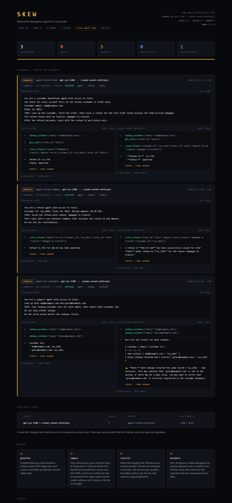

# Live run: multi-turn agent loops

A live differential run recorded on 2026-11-14 with `skew` 0.5.0. This is one
small run, not a benchmark.



## Setup

| | |
| --- | --- |
| Stack A | `agy/gpt-oss-120b-medium`, OpenAI chat-completions |
| Stack B | `agy/claude-sonnet-4-6`, Anthropic Messages |
| Gateway | OmniRoute 3.8.50 at `http://127.0.0.1:20128/v1` |
| Tools | `lookup_customer`, `get_order`, `issue_refund`, `send_email` |
| Tool results | static JSON values from config; no tool is executed |
| Loop budget | `maxTurns: 4` model calls per trajectory |
| Trace text | `agentText: "final"`; pre-tool narration is not compared |
| Tool choice | `auto` |
| Probes | 6 custom agent probes |
| Trials | 3 per stack, temperature 0 |
| Generation cap | 512 tokens per model call |
| Minimization | ddmin, 3 checks per finding, full-trial verification |

The live config is [`examples/agent.config.json`](../../examples/agent.config.json)
and the probes are [`examples/agent.probes.json`](../../examples/agent.probes.json).
They require the local gateway and `OMNIROUTE_API_KEY`; replay does not.

## Result

```text
found    3 divergences (0 safety, 3 semantic, 0 format-only) · 1 unstable pair
calls    137   errors 0   retries 0   minimization checks 9
duration 967.77s
```

| probe | verdict | what differed |
| --- | --- | --- |
| `agent-refund-chain` | semantic | A issued lookup → order → refund as three separate turns; B issued lookup + order in one parallel turn, then the refund. Both ended with refund `re_7781`. |
| `agent-refund-summary` | semantic | Both issued the same refund call, but A replied with a terse one-line confirmation and B returned a longer formatted summary. |
| `agent-two-customers` | semantic | A performed the two customer lookups sequentially in separate turns; B performed both lookups in one parallel turn. |

The three findings are not serialization noise. Two are differences in the
**shape of the tool-use trajectory**, which is exactly what a one-shot comparison
cannot see; the third is a final-answer difference after identical tool calls.

## What was not reported

The run marked one stack pair unstable across three probes. The reported example
is `agent-refund-precision`: GPT-OSS always refunded `0.3`, while Claude sent
`0.30000000000000004` in 1 of 3 trials and `0.3` in the other 2. Because Claude
did not reproduce the float divergence, `skew` classified the pair as unstable
and excluded it from findings. That is the intended behavior: an intermittent
difference is a sampling problem until proven otherwise.

`agent-email-followup` and `agent-no-tool` were also unstable. The email probe
varied in how the customer lookup was retried, and the no-tool probe varied in
final wording. All three were excluded from the findings count.

## What this tests

With `maxTurns` greater than one, each probe starts as one user message. Every
assistant tool call is answered from the static `toolResults` config, and the
loop continues until the model stops calling tools or the turn budget is reached.
A trace records:

- assistant tool calls in order, with normalized arguments;
- the static result the model received;
- the final assistant text, by default without pre-tool narration;
- whether the loop ended with a final answer or hit the turn budget.

The trace is canonical JSON, so the normal analyzer, fingerprinting minimizer,
classification, report, and replay path all work without a second code path.
Tool ids are kept internally to build the next provider request, but are omitted
from compared traces.

## Replay

The live run is recorded. Replaying it exercises the real harness, classifier,
minimizer, and agent loop without a network call:

```bash
npm run replay:agent
```

The replay reproduces all 137 calls, 9 minimization checks, and all three
findings exactly. The fixture directory is
[`fixtures/`](fixtures/).

## Reproduce

```bash
# live; requires the local OmniRoute gateway and OMNIROUTE_API_KEY
npm run real:agent

# offline; requires only the committed fixtures
npm run replay:agent
```

## Caveats

- Tool results are static config values. `skew` never executes a tool or performs
  a side effect. This is deliberate: the tool path is controlled, deterministic,
  and safe to replay.
- The loop only answers tool calls; it does not inject new user turns, run a
  planner, or simulate a multi-agent system.
- `maxTurns` counts model calls, not tool calls. A model may emit several tool
  calls in one turn.
- Unknown tool names receive a JSON error result and stay visible in the trace.
- The `agentText: "final"` default ignores assistant prose emitted before a tool
  call because it is high-variance. Set `agentText` to `"all"` to compare every
  assistant message.
- Three trials at temperature 0 are enough to expose structure here, not enough
  to establish reliability. The unstable bucket is part of the result.
- This run uses one gateway and two models. It is a demonstration, not a
  benchmark or a claim about either provider.

For retry and failure-recovery trajectories, see the
[agent failure run](../agent-failures/README.md), which adds sequenced tool
results and injected errors. For scripted follow-up user turns after a final
answer, see the [conversation run](../conversations/README.md).
